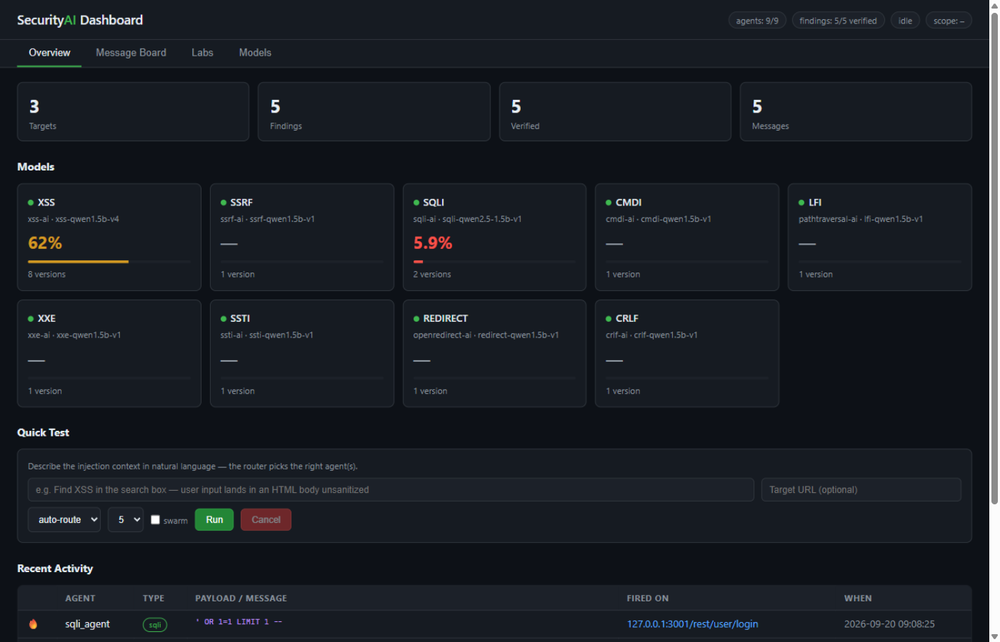
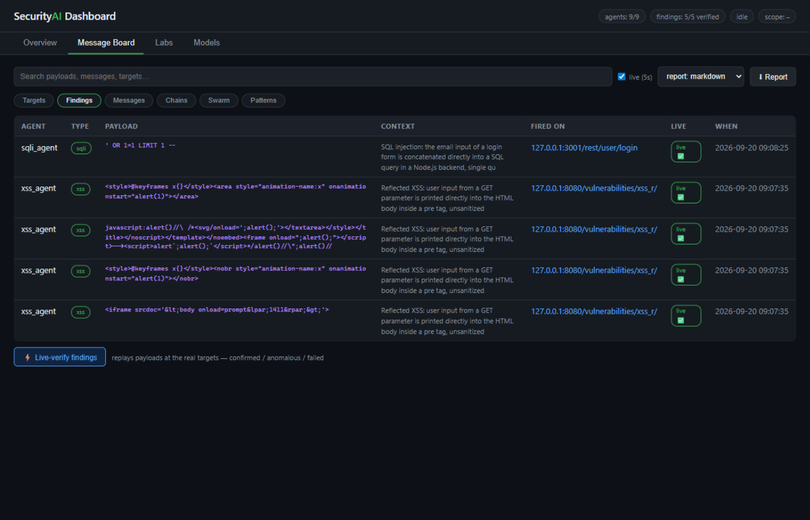

# SecurityAI

**A multi-agent vulnerability triage framework.** Nine vulnerability-type agents share one
message board: each generates payloads for the injection context it is given, verifies them
with its own oracle, and posts what fired. Findings cascade — an SSRF finding subscribes the
XXE and traversal agents to the same target — and the run ends with a report in HackerOne
format.

The framework, the nine oracles and the training pipeline are here, MIT-licensed. **The
trained model weights are not** — see [Models](#models).

If this saves you time: **[buy me a coffee](https://buymeacoffee.com/mux1337)**.






```
                 ┌───────────── Router (natural language → agents) ─────────────┐
                 │  Coordinator · Swarm protocol · Scope gate · MITM proxy      │
                 └───────────────────────────────┬──────────────────────────────┘
                                                 │  SQLite message board
     ┌────────┬────────┬────────┬────────┬───────┴─┬────────┬────────┬────────┐
    XSS     SSRF     SQLi     CMDi      LFI        XXE     SSTI   Redirect   CRLF
```

## Authorized testing only

This tool generates working exploit payloads. Use it on systems you own or have **written
permission** to test. That is the whole point of the scope gate below — please do not remove
it.

Scope enforcement is built in and fail-closed: every target passes `exploitgym/scope.yaml`
before an agent sees it. With no `scope.yaml` it runs in `lab` mode — loopback, private ranges
and reserved domains only; anything on the public internet is refused with a message naming
the mode. Copy `scope.example.yaml` to `scope.yaml` and add your program's domains before
testing anything real. The bundled labs (DVWA, Juice Shop, an SSRF lab) are deliberately
vulnerable Docker containers.

## What's here

| Directory | What it is |
|---|---|
| `exploitgym/` | Orchestrator: router, coordinator, swarm runtime, board, scope gate, recon crawler, patterns, reporter, dashboard, MITM proxy, retrain planner |
| `xss-ai/` … `crlf-ai/` | Nine agents: one per vulnerability class, each with its context taxonomy, oracle, data pipeline and training scripts |
| `malware-lab/` | Two defensive analysers: `analyze_pdf.py`, `monitor_network.py` |
| `docs/` | Getting started, model management, orchestrator guide, dashboard guide, adding a vulnerability type |

The oracles are the part that is hard to reimplement and the reason the framework is useful
even before you train anything: a headless-browser XSS oracle that only counts payloads that
actually execute, a SQLite oracle that does not mistake a syntax error for an injection, a
subprocess oracle for command injection, and so on.

## Quick start — verified from a clean environment

```bash
python -m venv .venv && . .venv/Scripts/activate      # Windows; bin/activate on Linux/macOS
python -m pip install -e "exploitgym[dev]"            # pydantic + pyyaml + pytest
cd exploitgym && pytest -q                            # 142 tests, all green
```

```bash
# what the swarm can do right now
python scripts/run.py --list-agents

# dashboard
python -m pip install -e ".[dashboard]"
python scripts/dashboard.py            # → http://127.0.0.1:9000

# MITM proxy: browse a target, injection points become swarm sessions
python -m pip install -e ".[proxy]"
python scripts/proxy.py --port 8080
```

Run something against the bundled labs:

```bash
python scripts/recon.py --url http://127.0.0.1:3001 --hunt     # crawl, register endpoints
python scripts/swarm.py --task "Find XSS: input reflected into HTML body" \
    --url http://127.0.0.1:3001/search
python scripts/report.py --format hackerone --out report.md
```

`docs/exploitgym-guide.md` has the full command set; `docs/dashboard-guide.md` has the four
tabs and the API. `exploitgym/demo-report.md` is the output of a real run against DVWA and
Juice Shop, five findings, each live-confirmed.

## The nine agents

| Project | Class | Generation CLI |
|---|---|---|
| `xss-ai` | Cross-site scripting | `xss-gen` (console script after `pip install -e .`) |
| `ssrf-ai` | Server-side request forgery | `scripts/06_generate.py` |
| `sqli-ai` | SQL injection | `scripts/06_generate.py` |
| `cmdi-ai` | Command injection | `scripts/06_generate.py` |
| `pathtraversal-ai` | Path traversal / LFI | `scripts/06_generate.py` |
| `xxe-ai` | XML external entity | `scripts/06_generate.py` |
| `ssti-ai` | Server-side template injection | `scripts/06_generate.py` |
| `openredirect-ai` | Open redirect | `scripts/06_generate.py` |
| `crlf-ai` | CRLF / header injection | `scripts/06_generate.py` |

Each project installs on its own: `pip install -e ".[dev]"` for the pipeline and oracle,
`.[ml]` for torch/transformers/peft/trl.

Without weights the framework still runs: board, recon, routing, dashboard, reports and the
scope gate all work, and `--list-agents` tells you exactly which models are missing. Any
dispatch that needs one fails with a single message naming the path.

## Models

**The trained weights are not in this repository.** They were ~87 GB of Qwen fine-tunes
across nine agents and several versions each. Two supported paths:

1. **Train your own.** Every agent ships its data pipeline and trainer
   (`scripts/01_fetch_corpora.py` → … → `08_train.py`), the context taxonomy it trains on, and
   its oracle. `docs/model-management.md` covers base-model choice, versions and swapping. A
   12 GB GPU trains a 1.5B payload model in a few hours.
2. **Point at a model you already have.** `exploitgym/src/exploitgym/config.py` maps each
   agent to a model directory relative to its project. Point `model_path` at any compatible
   causal LM (a local HF directory) and the agent will use it.

The training corpora are also not committed — they are regenerated by the pipeline
(`01_fetch_corpora.py` → `04_finalize_splits.py`). What is committed is the seed material
that cannot be regenerated: the context taxonomies, the hand-curated hard-context and
targeted payload sets, and the validation reports.

**What the reference run reached**, with those models, for calibration only — you cannot
reproduce these numbers from this repository alone: 61.6 % XSS T1, 96.9 % SSRF T1, 100 % on
CMDi, XXE, SSTI, open-redirect and CRLF, 79.3 % traversal on the synthetic benchmark, with
SSRF and SQLi additionally live-confirmed against Juice Shop.

## Lessons the pipeline encodes

1. **Fine-tuning beats prompting** — a 1.5B fine-tune scored 61.6 % where a 14B prompted model scored 5 %.
2. **Targeted data beats model size** — 90 targeted breakout payloads moved XSS +21.8 %; 3B and 4B models on the same data matched 1.5B.
3. **Train only on payloads that actually fire** — the browser oracle is the label, not a regex.
4. **Data composition matters** — hard-context payloads added without balance hurt easy-context performance.
5. **Oracle fidelity is load-bearing** — a lenient oracle (counting SQL syntax errors as fires) inflated a model to a fake 70 % and taught it the wrong dialect; live-target testing exposed 0/6.
6. **Live labs are the real benchmark** — simulated scores are necessary, not sufficient.

## Requirements

- Python 3.11+ (framework); 3.12 for the ML stack
- NVIDIA GPU with 12 GB+ VRAM — only if you train or run local models
- Docker Desktop — only for the bundled labs

## Licence

MIT — see `LICENSE`. No model weights are distributed here, so no model licence attaches to
this repository; if you train on a base model, its licence governs the weights you produce.
`malware-lab/` contains only this project's own analysers and does not vendor any sandbox.
